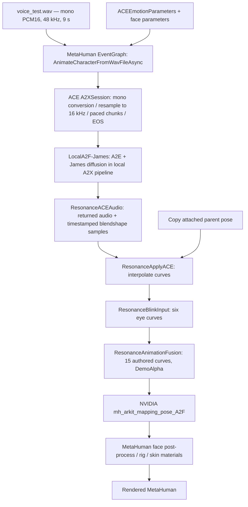

# Resonance Audio2Face / Audio2Emotion audit — 31 October 2026

## Finding and smallest justified change

**The currently saved James pipeline does not reproduce the reported absence of emotional motion.** Automatic inference produced substantial brow, cheek and mouth-corner curves; explicit neutral, sadness and anger configurations changed those curves and the MetaHuman's facial joints. In model mode the authored fusion alpha was exactly zero throughout every capture. The investigation therefore does **not** establish an accidentally active expression override, a mouth-only mapping, or general suppression by AnimationFusion as the current cause.

This does not establish emotionally appropriate or natural animation. Large ARKit weights are not emotion-recognition scores or perceptual validation. Some automatic brow values already reach 1.0, while a recorded image still looks restrained. The remaining question concerns the intended expression, its timing and visible rig response, rather than simply insufficient numerical amplitude.

**Retain James and the current mapping.** For a client whose emotional intent is known, the smallest demonstrated control is an explicit `ACEEmotionParameters` state on the existing speech request. Sadness and anger overrides work through the current pipeline; an additional model is not yet justified. Use moderate, evaluated intensities in a subsequent implementation experiment, because the diagnostic strength-1 overrides also changed jaw articulation. If the requirement is specifically automatic emotion inference, first expose timestamped A2E and pre-fusion outputs and evaluate them against labelled speech; the present measurements cannot identify an A2E classification failure.

No permanent fix, plugin update, model installation, or production-asset edit was made.

## 1. Evidence, environment and protection

The connected editor reported **UE 5.6.1-44394996** and the project at `unreal/ResonanceVR`. The open map was `/Game/Resonance/Levels/I_Resonance`; PIE was initially stopped. NVIDIA telemetry verified the **RTX 5070 Laptop GPU**, reporting 8151 MiB total memory. Only `LocalA2F-James` was used for inference. Enabling several provider plugins in the project does not mean their large inference instances were all allocated.

`README.md`, project builders, installed NVIDIA source, plugin/model metadata, live saved Blueprint graphs, PIE values, facial output and logs were inspected. There was no existing `graphify-out/graph.json`; conclusions below use direct source/asset evidence. No architecture diagram was treated as proof of implementation.

Before testing, Unreal reported no dirty content packages or maps. Tests changed PIE objects only, temporarily disabled background CPU throttling, and sampled the existing character. Throttling was restored to `true`, `a2f3d.dump` to `false`, and PIE was stopped. The last successful dirty-package check still returned empty lists. Nothing was saved through Unreal.

After all captures and restoration, the optional call to `FreeA2F3DResources("LocalA2F-James")` caused a **native NVIDIA teardown exception**; subsequent editor Python RPC timed out. See performance/stability below. No force-close or further release attempt was made. Thus the editor was not left in a verified healthy RPC state, despite successful playback tests.

Evidence is local and deliberately outside production Content assets:

- [Complete machine-readable summary](../unreal/ResonanceVR/Saved/A2F-Audit/summary.json).
- [Executed condition list](../unreal/ResonanceVR/Saved/A2F-Audit/executed_protocol.json).
- [Saved character EventGraph](../unreal/ResonanceVR/Saved/A2F-Audit/character-EventGraph.json), [face AnimGraph](../unreal/ResonanceVR/Saved/A2F-Audit/face-AnimGraph.json), [face EventGraph](../unreal/ResonanceVR/Saved/A2F-Audit/face-EventGraph.json).
- [Runtime properties](../unreal/ResonanceVR/Saved/A2F-Audit/runtime_properties.json), [runtime log excerpt](../unreal/ResonanceVR/Saved/A2F-Audit/runtime-log-excerpt.txt), [GPU/process telemetry](../unreal/ResonanceVR/Saved/A2F-Audit/telemetry.jsonl).
- Per-condition JSON files contain timestamped final curves, joints, animated skin parameters, fusion/blink values, submission status and sampling gaps.

`Saved` is local evidence, not a promise that these files will accompany a fresh clone. Archive the directory before cleaning project intermediates. Setup attempts encountered Python API naming/visibility differences; the retained `error.txt` is an earlier harness setup error, **not a failure of one of the 13 completed conditions**.

## 2. Verified current architecture

### Inventory

| Item | Verified value | Evidence |
|---|---|---|
| ACE base plugin | `2.5.0-20250614-2282` | `Plugins/NV_ACE_Reference/NV_ACE_Reference.uplugin`; startup log agrees |
| Model-provider plugin packages | `2.4.0-20250610-2270` | Their `.uplugin` descriptors and startup logs |
| Selected provider | `LocalA2F-James` | Saved `ResonanceAnimateSpeech` pin and actual `sending wav file ... to LocalA2F-James` log |
| Selected A2F model | James diffusion **v3.0**, nominal output 60 samples/s | `NvAudio2FaceJames.uplugin`; A2F `VERSION.md` says `v3.0` |
| Other installed/enabled A2F packages | Mark diffusion 3.0/60; Claire, Mark and James regressive 2.3/30 | `.uproject`, provider descriptors |
| Inference location | Local NVIDIA TensorRT/CUDA A2X pipeline | `A2FLocalJamesModule.cpp`, `A2FLocal.cpp`, runtime provider log |
| Character | `/Game/MetaHumans/New_realistic_character/BP_New_realistic_character` | Saved asset and PIE actor class |
| Face AnimBP | `/Game/Resonance/Animation/ABP_ResonanceFace` | Actual PIE face anim instance |
| Post-process | `ABP_Face_PostProcess_C` | Actual PIE post-process instance |
| LOD | LODSync 2; mesh API forced value 3 (1-based) | Builder and runtime properties |

Paths in this report beginning with `Plugins`, `Content`, or `Saved` are relative to `unreal/ResonanceVR`.

### Audio-to-rendered-face path



1. The character's compiled EventGraph gates autoplay to `I_Resonance`, waits two seconds, builds the loose WAV path from the Content directory, and submits it through `AnimateCharacterFromWavFileAsync`. Replays recur every 36 seconds. X/Y mode selections also request replay; a send lock and one pending replay prevent concurrent submissions. Replay explicitly stops the previous character playback before sending. Submission completion is distinct from audible playback completion.
2. Input is `Content/Resonance/Audio/voice_test.wav`: independently checked as 9.000 seconds, one channel, 48 kHz, two-byte PCM samples. SHA-256: `86cc1d3778b2f2d45a62f4c869000528bf9b2ae582a3911800a9234780e15a2f`.
3. `ACEBlueprintLibrary.cpp::AnimateCharacterFromWavFile` loads/parses the WAV and calls `FACERuntimeModule::AnimateFromAudioSamples`. `A2XSession.cpp` handles mono conversion and 16 kHz resampling. This original 48 kHz file is therefore **not** fed unchanged to the neural network, even though it is the application input.
4. The local provider creates a combined A2F/A2E pipeline. Current ACE settings resolve to burst mode `Default`, initial chunk limit 0.5 s. Observed sends subsequently used 560-sample/35 ms chunks, consistent with paced rather than unrestricted burst execution.
5. `AIMA2FContext.cpp::CreateChunkFromAIMOutputs` receives audio and blendshapes. Local timestamps are derived from output audio byte counts; original audio can be passed through using the sample-rate ratio. This is not a measured hardware audio/render synchronization guarantee.
6. `ACEAudioCurveSourceComponent.cpp` queues audio in a procedural sound wave and caches timestamped curves. Its actual buffer length was 0.1 s. It aligns animation to an audio-playback estimate, interpolates between samples and compensates for underflow silence. `AnimNode_ApplyACEAnimation.cpp` applies those ARKit-compatible values.
7. The saved pose graph has the exact chain shown above. It uses NVIDIA's alternative pose mapping and contains no extra legacy MetaHuman MouthClose block. Actual post-process facial joints and animated skin parameters changed during captures.

### Relevant first-party implementation

| Location | Role |
|---|---|
| `Content/Python/build_resonance_audio2face.py:15–29` | Explicit provider, emotion tuple, upper-face/blink values; speech-node configuration |
| `Content/Python/build_resonance_face_modes.py::build_character` | Autoplay, WAV path, serialization, replay queue, mode state and face parameter object |
| `Content/Python/build_resonance_full_face.py::build_animation` | Authored curve sampling, `DemoAlpha`, mode fade and final fusion wiring |
| `Content/Python/build_resonance_blink.py::add_scheduler`, `connect_pose` | Procedural blink scheduling and six-curve blend alpha |
| `Content/Python/resonance_face_demo.py` | 36-second authored trajectory, 15 owned channels |
| `Content/Python/ace_face_nodes.txt` | Native graph template; live saved graph was inspected separately |
| `Content/Python/verify_resonance_audio2face.py` | Existing final-pose verifier; labels provider/settings from builder constants, not live request interception |

The Python contract harness under `src/resonance_pipeline` is **separate**. `PlaceholderAudio2Face` drives jaw/mouth placeholders; `LocalAudioEmotion` derives a deterministic proxy from RMS; Python `AnimationFusion.combine` adds and clamps signal channels. None of these constitute NVIDIA A2E or the Unreal runtime fusion implementation. No connection from that orchestrator to the tested MetaHuman was found in this implementation path.

## 3. Audio2Emotion integration and actual settings

### Version and execution

The selected James package contains:

```text
Plugins/NvAudio2FaceJames/ThirdParty/Nvigi/Models/
  nvaim.plugin.a2e.trt/{E5E4043F-5BC9-4175-B510-A563A5BFB035}/
    VERSION.md             = 2.1.0-2025-03-17
    model.json             = name "audio to emotion", vram 1800
    network_info.json      = 16000 Hz; angry/disgust/fear/happy/neutral/sad
    a2e_ms_config.json
    a2e_network.trt
```

**The bundled A2E package is labelled `2.1.0-2025-03-17`; it is not labelled A2E 3.0.** No independent neural-network revision or authoritative mapping of this particular serialized engine to an advertised A2E release was found. Package version, SDK/interface version and learned-model revision must remain distinct. The A2F directory's separate marker says `v3.0`. Current NVIDIA documentation describing newer A2E releases does not identify this installed binary retrospectively.

`A2FLocal.cpp::CreateA2FInstanceInternal` explicitly installs both the A2F and A2E CUDA plugin IDs in `A2XCreationParameters` and hardcodes the A2E model GUID above. Thus automatic A2E is part of this provider's normal execution; it is not supplied by the Python `LocalAudioEmotion` class. Local setup/configuration and output differences establish an active emotion-conditioned pipeline. Direct classifier scores were not observed.

There is **no exposed independent A2E enable/disable control in this provider path**. Setting overall strength to zero neutralizes emotion conditioning; setting override strength to one replaces inferred conditioning. Neither proves that classifier GPU computation has been disabled. The installed runtime header also has internal scheduling fields, but the application does not expose them as an inference-disable option. Do not transplant newer NIM `a2e.enabled` settings into this local provider.

### Actual request values, not generic defaults

The saved `ResonanceAnimateSpeech` node was read from the editor. Its unlinked emotion pin contains the following values. Diagnostic requests separately record their complete constructed emotion struct in each result JSON.

| Parameter | Current speech request | Installed struct default | Interpretation |
|---|---:|---:|---|
| Overall Emotion Strength | **1.0** | 0.6 | Already at documented maximum; increasing beyond current value is not a valid next step |
| Detected Emotion Contrast | **1.0** | 1.0 | No extra contrast boost |
| Max Detected Emotions | **3** | 3 | Limits strongest selected emotions; model config's six is overridden |
| Detected Emotion Smoothing | **0.7** | 0.7 | Can delay/flatten short changes; tested at zero separately |
| Enable Emotion Override | **false** | true | No application blending in normal speech request |
| Emotion Override Strength | **0.0** | 0.5 | Inferred conditioning selected |
| Individual override flags | **all false** | all false | No unintended requested anger/sadness/etc. |
| Individual override values | **all 0.0** | all 0.0 | Inactive because the flags/global override are disabled |

`AIMA2FContext.cpp:234–260` maps these fields directly to `emotionContrast`, `emotionStrength`, `liveBlendCoef`, `maxEmotions`, `enablePreferredEmotion` and `preferredEmotionStrength`. It chains local A2E runtime parameters; enabled individual overrides go into `Audio2EmotionPreferredEmotion`. Disabled individual entries use an unassigned sentinel rather than an explicit zero. The source contains a separate workaround for remote override handling; the tested path is local.

The ten application controls are amazement, anger, cheekiness, disgust, fear, grief, joy, out-of-breath, pain and sadness. The bundled classifier itself lists only **angry, disgust, fear, happy, neutral and sad**. Its correspondence maps angry→1, disgust→3, fear→4, happy→6, sad→9 and neutral→−1 in the ten-control space. Exposing ten override sliders does not mean the classifier detects ten independent categories. NVIDIA's [A2E configuration explanation](https://github.com/NVIDIA/Audio2Face-3D-Training-Framework/blob/main/docs/using_maya_ace.md) documents this distinction.

The installed `a2e_ms_config.json` additionally contains `transition_smoothing=0.5`, `fixed_dt=0.033`, and a 60000-sample audio buffer at 16 kHz. These are installed model configuration values; their precise effective internal temporal response was not instrumented. They are separate from the request's detected-emotion smoothing. SDK documentation explains windowed emotion inference and remapping in the [Audio2X architecture](https://github.com/NVIDIA/Audio2Face-3D-SDK/blob/main/docs/README.md).

### Logging limitation

`AIMA2FContext.cpp:622–706` locates the emotion output slot, then explicitly declines to pass its values onward. The commented extraction describes ten floats. Consequently neither the current Blueprint nor Python verifier can log actual inferred scores. The available `a2f3d.dump` cvar dumps audio WAVs, **not raw curve or emotion CSVs**. It was restored to false; this audit did not add a logger or rebuild NVIDIA code.

### Facial values and smoothing

| Setting | Current resolved value | Evidence strength |
|---|---:|---|
| `upperFaceStrength` | 1.0 | Explicit saved Blueprint `SetParameter`, used in diagnostic requests |
| `blinkStrength` | 1.0 | Explicit saved Blueprint `SetParameter`, used in diagnostic requests |
| `lowerFaceStrength` | 1.0 | Selected model config + provider default-loading/merge source; no per-request override |
| `skinStrength` / `inputStrength` | 1.0 / 1.0 | Same resolved configuration path |
| `upperFaceSmoothing` | 0.001 | Same resolved configuration path |
| `lowerFaceSmoothing` | 0.006 | Same resolved configuration path |
| Face mask level / softness | 0.6 / 0.0085 | Same resolved configuration path |
| `lipOpenOffset` | −0.02 | Same resolved configuration path |
| Apply ACE blendshape multipliers / offsets | **empty / empty** | Live saved node struct inspection |
| Apply ACE interpolation | **true** | Live saved node struct inspection |
| Blend out to zero / rate | **true / 10.0** | Live saved node struct inspection |

`A2FLocalJamesModule.cpp` loads the selected model defaults through `GetDefaultFaceParams30`; `FAggregateAIMRuntimeParams` applies those first, then explicit request overrides. This resolves the lower-face/smoothing values from this installed configuration, rather than substituting documentation defaults. Internal kernel parameter readback was not available.

Interpolation can reduce sampled short peaks, and post-speech decay intentionally neutralizes the face. Neither is a global emotional amplitude multiplier during valid continuous output. No application curve multiplier reducing all emotion was found.

## 4. Controlled tests and results

### Protocol and limits

All A–G and repeats used the identical nine-second `voice_test.wav`, James only, normal face/blink strengths and the same MetaHuman/LOD. Each capture lasted at least 16 wall-clock seconds, followed by a two-second settling period. Existing periodic replays were gated in PIE. No source WAV was changed or normalized.

A preserves current procedural blinking. B–G and repeats set the procedural scheduler's next blink far in the future and its closure to zero; the measured closure remained exactly zero. Authored mode was false and measured fusion alpha was **[0,0] in all 13 captures**. B–D enable **all ten individual override flags**, explicitly zero all other categories, enable application overrides and use **override strength 1.0**. Neutral therefore means a fully specified zero emotion vector; it does not mean freezing speech or forcing all facial curves to zero.

F is **functional alpha-zero isolation**: both additional ModifyCurve blends are transparent. The nodes were not physically removed and no separate pre-fusion recording was made. This is sufficient to test whether their nonzero blending suppresses output, but is not a raw-model export or an independently rebuilt graph comparison.

Measured curves are final face AnimInstance ARKit-named values after the graph, not raw TensorRT predictions. Component-space joint positions and animated skin-material scalars provide a downstream rig check. No video, acoustic loopback, emotion-score trace or human rating was recorded. Single-condition peaks are descriptive, not statistical treatment-effect estimates; diffusion/state/sampling variability was not controlled with a fixed inference seed.

### A–F execution and observations

| Test | Configuration and status | Observation and interpretation | Confidence |
|---|---|---|---|
| A | Automatic; strength 1, smoothing .7, current blinks. **Completed**, 955 samples | Strong upper-face/cheek curves; authored alpha zero. Current global absence of expression not reproduced | High for measured motion; no naturalness claim |
| B | Explicit neutral vector, override blend 1. **Completed**, 949 samples | Less cheek/outer-brow activity than A; speech and residual face motion remain. Neutral conditioning is not an expressionless rig | High for applied configuration/output |
| C | Sadness 1, all other categories 0, override blend 1. **Completed**, 952 samples | Different brow/eye/mouth output and moving rig joints. Controlled expression works; semantic recognizability untested | High for controllability; moderate for attribution without repeated fixed-seed runs |
| D | Anger 1, all other categories 0, override blend 1. **Completed**, 948 samples | Strong brow-down/cheek activity and changed jaw motion. No general integration blockage | High for controllability; same attribution limit |
| E | Automatic strength .6 compared with 1; repeated without screenshots. **Completed** | Strength affects some channels; current baseline is already 1. Cannot increase it further within supported range. Repeats vary substantially, so no precise gain estimate | Moderate |
| F | Automatic; authored/blink alpha zero. **Completed**, then repeated twice | First capture compromised: 495 received frames, delayed audio start and sparse sampling. Both repeats received 539 frames and retained strong expression. Alpha-zero fusion does not remove expression | High for alpha/output; first run unsuitable for quantitative model comparison |

G additionally tested detected-emotion smoothing **0**. It completed successfully. Its peaks closely resemble automatic .7 repeats; this clip supplies no evidence that .7 is the main reason expressions are weak. Shorter annotated emotion transitions and actual A2E traces are needed before recommending a smoothing change.

### Peak final curve values

Peaks can occur at different times; they do not describe one simultaneous facial pose. `MouthSmile` is a rig coefficient, not a reliable joy label. B–D and F exclude procedural blinks.

| Condition | Inner brow | Left brow down | Left eye wide | Left cheek squint | Left mouth smile | Left mouth frown | Jaw open |
|---|---:|---:|---:|---:|---:|---:|---:|
| A current automatic | 1.000 | .939 | .377 | .345 | .990 | .171 | .545 |
| B explicit neutral | .804 | .509 | .120 | .125 | .756 | .092 | .478 |
| C explicit sadness | 1.000 | .703 | .448 | .251 | .445 | .074 | .423 |
| D explicit anger | 1.000 | 1.000 | .160 | .463 | .886 | .205 | .716 |
| E .6, initial | .818 | .895 | .173 | .248 | .534 | .084 | .475 |
| E .6, repeat without screenshot | 1.000 | .498 | .173 | .261 | .892 | .108 | .523 |
| F initial, compromised | 1.000 | .707 | .210 | .214 | .972 | .036 | .478 |
| F repeat | 1.000 | .947 | .379 | .351 | .972 | .170 | .543 |
| F second repeat, no screenshot | 1.000 | .944 | .377 | .337 | .985 | .174 | .544 |
| G smoothing zero | 1.000 | .939 | .377 | .344 | .996 | .164 | .535 |

Downstream joint checks also changed. For example, maximum left lip-corner displacement from the first sample was approximately .914 cm in B, .678 cm in C and 1.082 cm in D; left cheek-outer displacement was .376/.309/.556 cm. These measures show rig movement, not anatomical ground truth or emotion intensity. Skin parameter ranges are retained in each JSON. The named jaw, eyelid, forehead, cheek, nose and lip-corner joints were verified to exist.

Procedural blinking raises A's left blink peak to .987, versus about .138–.139 in the automatic F repeats. Reliable closure is therefore largely procedural in this recording, not evidence of accurate A2E inference.

An example [F isolation screenshot](../unreal/ResonanceVR/Saved/A2F-Audit/F_auto_transparent_fusion.png) shows the actual character. Screenshots were requested after roughly four seconds in E/F/G and several later runs; they are neither synchronized peak comparisons nor video. The short German samples may already have ended by their screenshot time. Those images must not be used as evidence of missing emotion during speech. No B/C/D comparison screenshots were captured.

### Diagnostic cases

- **Case 1, overrides work but automatic inference is weak:** Override control is demonstrated, but automatic motion is also strong. Misclassification, poor emotional appropriateness or insufficient sustained emotion remain hypotheses because classifier scores and perception were not measured.
- **Case 2, overrides do not work:** Not supported as a general failure here. C/D produce distinct curves and facial-joint movement. Natural-looking sadness/anger is still unproven.
- **Case 3, raw emotion curves move but MetaHuman suppresses them:** Not directly tested, because raw output is unavailable. Correct mapping, changing rig joints and zero fusion alpha argue against a complete suppression failure; they cannot rule out channel-specific retargeting losses or perceptually weak poses.

## 5. MetaHuman / AnimationFusion analysis

`ResonanceAnimationFusion` is a **Modify Curve node in Blend mode**, not the additive/clamping Python class. For each of its 15 owned channels its operation is effectively:

`final = (1 - DemoAlpha) * composed_model_value + DemoAlpha * authored_value`

X drives alpha toward one: it replaces eye blink/wide/squint, inner/outer/down brows, cheek squint and nose sneer with authored trajectories. Consequently **X intentionally suppresses model expression in those channels**, including replacing a nonzero model curve with an authored zero. Mouth corners and jaw are not owned by this layer and pass through. This is a controlled showcase, not an emotion-detector baseline.

Y/default drives alpha toward zero using `FInterpTo` at speed 12. The fade applies to mode changes, not to every inferred emotion value. In the observed settled Y captures alpha was exactly zero, so authored sequences were not attenuating expression.

The earlier blink layer applies `lerp(modelBlink,1,proceduralClosure)` to both eyelids and moves eye-wide/squint toward zero during closure. Thus blinks **temporarily suppress these four eye-expression channels by design**. Brows, cheeks, nose, mouth corners and jaw are not modified by that blink node. This cannot explain their wholesale absence.

The observed mapping order agrees with NVIDIA's [ACE 2.5 character setup](https://docs.nvidia.com/ace/ace-unreal-plugin/2.5/ace-unreal-plugin-animation.html): ACE before the ARKit pose mapping, the supplied `mh_arkit_mapping_pose_A2F`, and no legacy MouthClose correction block. The vendor mapping specifically changes some brow and mouth poses. Its use is verified; optimal expressiveness of each mapping on this new character is not.

At strength 1, some coefficients saturate. Applying a blanket multiplier would risk clipping and an unnatural face rather than recover missing semantic expression. The bangs visibly overlap part of the brow region in the screenshot; this may affect observation but was not isolated as a cause. LOD2 and the current camera/lighting are additional perceptual conditions to hold fixed during comparison.

**Articulation and emotion are not independent inside the tested model.** Identical audio produced jaw peaks .478 neutral, .423 sadness and .716 anger. This does not measure lip-sync error, but it rules out claiming that global emotion overrides preserve mouth motion unchanged. A future upper-face-only expression overlay could preserve lower-face curves by construction; it would need explicit channel ownership, reference timing and one final fusion authority. Do not add a second downstream curve writer.

## 6. German-language evaluation

Three existing EmoDB samples were selected from repository annotations: same speaker **3**, same sentence **a05**, different performed emotions. The sentence is “Das schwarze Stück Papier befindet sich da oben neben dem Holzstück.” All are mono 16 kHz PCM16. These additional runs used automatic emotion, strength 1, smoothing .7, transparent fusion and no procedural blinks.

| Sample | Duration | Existing annotation confidence / naturalness | Execution | Brow down L | Mouth smile L | Mouth frown L | Jaw |
|---|---:|---|---|---:|---:|---:|---:|
| `03a05Nd.wav` neutral | 3.168 s | 1.0 / .90 | Completed | .641 | .405 | .022 | .297 |
| `03a05Wa.wav` anger | 3.44075 s | 1.0 / .85 | Completed | .872 | .898 | .210 | .631 |
| `03a05Tc.wav` sadness | 3.4978125 s | .85 / .50 | Completed | .642 | .346 | .099 | .215 |

The selected sadness take is `Tc`, not the lower-confidence `Ta` considered during setup. Exact headers, annotations and hashes are in `summary.json`. Confidence/naturalness here are **dataset annotations**, not scores produced by NVIDIA.

The inputs produce different animation. Anger has stronger brow lowering and jaw motion, but the experiment cannot separate acoustic articulation differences, model behavior and inferred emotion. The neutral take also peaks at inner brow 1.0; this illustrates why facial amplitude alone is not emotion-classification accuracy. Three performed takes from one speaker are not a German accuracy benchmark. Speaking intensity was not manipulated independently, no matched English reference was selected, and the origin/prosody quality of `voice_test.wav` was not established. Nothing here demonstrates that synthetic speech is responsible, or that German is less reliable than English.

German lip articulation and German emotion classification remain separate validation questions. A defensible next comparison would use multiple labelled German speakers/sentences, counterbalanced automatic and explicit conditioning, raw A2E outputs, and blinded ratings; add matched English material only if testing a language effect.

## 7. Performance and stability

| Measurement | Observed result | What it means |
|---|---|---|
| GPU before PIE/model initialization | 2025 MiB used; 5867 MiB free reported | Whole GPU snapshot, not a per-model allocation |
| GPU during 150 telemetry samples | **6414–6444 MiB used**, **1448–1478 MiB free** | Only one diffusion provider active; modest remaining headroom |
| GPU utilization | 0–77% | Coarse whole-GPU samples; combines rendering/inference/other work |
| Unreal working set | **5.18–5.47 GiB** | Resident process memory, not total system RAM |
| Unreal private commit | **10.76–11.07 GiB** | Committed private virtual memory, not resident RAM |
| Normal nine-second submission completion | approximately **8.72–8.86 s** | Paced sending + processing; not isolated GPU inference latency |
| Warm request→audio-start log delay | typically **.766–.923 s** for full nine-second runs | Application/log proxy; excludes physical audio-device and display latency |
| First cold autoplay request→audio start | approximately **6.34 s** | Includes model initialization; not a repeated cold-start benchmark |
| Normal full nine-second received animation | **539 samples** | Roughly 60 output samples/s; says nothing about headset rendering FPS |
| Initial F anomaly | 2.193 s audio-start delay, 495 received samples | Compromised run; do not use for a clean amplitude comparison |

Before screenshots, A–D captured roughly 949–955 final poses per 16 seconds, with average sample gaps around 16.8 ms. Later screenshot-bearing runs had gaps as large as 0.375 s. A clean E repeat returned 950 samples, mean gap 16.86 ms. These are **editor callback sampling/tick measurements**, not a dedicated render-thread/GPU profile or certified VR frame budget. Screenshot activity and background scheduling contaminate timing; no Quest 3 performance claim is justified.

Actual classifier GPU time, diffusion kernel time, blendshape-solver time and hardware audiovisual skew were not separately instrumented. System-wide RAM query was denied by the environment; process figures were available. The supplied 32 GB system specification is user context, not independently measured available RAM.

All 13 recorded submissions reported success. This is not a blanket stability pass: one local polling-thread timeout warning occurred, and F's first run was incomplete relative to normal frame counts. No OOM appeared in these tests. Multiple diffusion models were never loaded concurrently and no VR stress test was attempted. NVIDIA's [2.5 troubleshooting guidance](https://docs.nvidia.com/ace/ace-unreal-plugin/2.5/ace-unreal-plugin-troubleshooting.html) also notes instability with simultaneous local sessions.

**Teardown failure:** after capture completion, settings restoration, clean-package verification and PIE stop, the optional James resource-release request returned, then the log at `2026.10.31-18.03.26:551` reported a native exception and NVIDIA minidump creation. The stack includes `FAIMInferenceInstanceRef::DestroyInstance`, `FA2FLocal::FreeResources`, and native A2F/A2E pipeline frames. A subsequent Python request timed out after 30 s. The OS still listed the editor process as responding, which does not prove the engine or RPC loop is healthy. This is a reproducible sequence observed once, not proof of a specific ownership bug. Preserve the log/minidump for a vendor investigation; do not repeat resource teardown casually. No new engine crash artifact in `Saved/Crashes` was identified; the reported minidump location is under NVIDIA's ProgramData directory.

GPU memory fell to roughly 4.15–4.19 GiB after the release request, not to the original pre-PIE snapshot. Do not interpret this as a confirmed leak: render caches, driver allocations and partially completed teardown were not separated.

The log subsequently recorded an audio hardware wait timeout of 167 seconds. Its relation to the native teardown exception is not established. This further limits any claim that the editor recovered normally after release.

## 8. Ranked causes and diagnostic gaps

| Priority | Finding / hypothesis | Status and confidence |
|---|---|---|
| 1 | Current observations differ from the reported weak-expression baseline | **Confirmed, high:** saved James config is strength 1 with overrides off and produces strong measured motion. Reconfirm exact mode/map/build for the problematic observation |
| 2 | Native resource teardown instability | **Confirmed occurrence, high:** exception after explicit free; exact defect unresolved. Important operational issue, separate from emotion quality |
| 3 | No A2E/pre-fusion observability | **Confirmed, high:** source discards emotion slot; existing verifier reads final pose and builder constants. Prevents locating inference versus mapping loss |
| 4 | X authored mode hides selected model expression | **Confirmed mechanism, high:** replacement at alpha 1. Not active in measured Y, so not its root cause |
| 5 | Procedural blinks confound a “model-only” baseline | **Confirmed, high:** normal Y includes them; only eye-wide/squint temporarily suppressed |
| 6 | Intended emotion differs from automatic acoustic inference or model performance | **Plausible, unresolved:** overrides offer control; no classifier trace or human ratings establishes a classification failure |
| 7 | Channel-specific mapping/LOD/visibility reduces perceived expression | **Plausible, unresolved:** correct mapping and joints move, but raw→rig transfer and perception were not quantified |
| 8 | Excessive smoothing/global attenuation | **Not supported as primary current cause:** strength already 1, face strengths normal, multipliers empty; zero detected-emotion smoothing did not visibly increase measured peak ranges consistently |
| 9 | German generalization or synthetic prosody is the cause | **Unestablished:** insufficient controlled multilingual/prosody evidence |

`unreal/AUDIO2FACE.md` contains historical Claire/Mark measurements and the previous empty-override blending correction. The saved James node already includes that correction. Reapplying it would not be a new improvement. Historical claims should not be mixed with this current-version audit.

## 9. Alternatives and prioritized recommendations

| Option | Expected benefit for this project | Complexity / runtime implications | Recommendation |
|---|---|---|---|
| A: Keep A2F, improve emotion control and observability | Existing override API demonstrably changes final face. Preserve current provider, rig and replay path | Small request/config work; telemetry requires a careful plugin/adapter extension. Current A2E still runs | **First choice** |
| B: Separate emotion inference or explicit client state | Explicit state can express conversational intent that audio alone may not convey | Explicit state avoids an additional classifier. Another learned model adds integration, validation and memory cost | Prefer known client state; evaluate another classifier only after measuring current A2E errors |
| C: MetaHuman Animator audio baseline | Native MetaHuman solve provides a useful independent offline comparison | Different asset/solve and realtime workflows; performance/quality here unmeasured | Small isolated comparison later; no migration justified yet |
| D: Custom hybrid articulation/expression/smoothing/minimal head motion | Explicit channel ownership can protect mouth curves and control expression timing | More scheduling, transition, cancellation and conflict logic; broader implementation/testing burden | Only if existing overrides cannot meet verified quality/lip-sync requirements |

Epic documents both [offline audio-driven animation](https://dev.epicgames.com/documentation/en-us/metahuman/audio-driven-animation) and realtime audio via Live Link. Running the “Realtime Audio” solver **inside a MetaHuman Performance asset remains an offline processing workflow**; it is not live streaming. The offline 5.6 workflow offers mood/intensity, blinks, masks and optional head movement. Realtime capabilities and controls must be checked against the installed 5.6 headers/plugins, rather than assuming newer documentation applies. No MetaHuman Animator solve was executed and its plugin/model was not enabled or downloaded for this audit.

Ordered next steps:

1. **Preserve evidence and stabilize teardown.** Archive the audit directory and the native exception log. Use a normal editor recovery/restart when appropriate; do not ship an automatic runtime model-release path until it is tested with this plugin build. No plugin version change is proposed without a separate review.
2. **Reproduce the precise perceptual complaint.** Use this exact map/character and identify X versus Y, clip, expected emotion and timestamps. Existing Y already has strong curves. Benefit: prevents fixing an obsolete provider/configuration or comparing different modes.
3. **Add observability before changing inference.** Capture request values, stream/sample timestamps, received ARKit curves before ModifyCurve, post-blink/fusion values, mapped rig controls and inferred A2E values. Keep raw/processed/final stages distinct and avoid misleading labels based on builder constants. Benefit: distinguishes the requested diagnostic cases directly.
4. **For known emotional intent, trial the existing override input.** This is the smallest behavior change supported by the tests. Explicitly enable relevant override flags and choose a nonzero blend strength. Use fully specified vectors for experimental baselines. Evaluate moderate intensity/blend values and expression timing; avoid a permanent strength-1 diagnostic setting. Compare articulation against the neutral/automatic reference before accepting it.
5. **Keep a selectable pure model baseline.** Add an explicit procedural-blink-off experiment flag while preserving one final fusion authority. Y currently includes blinks and cannot be labelled pure model output.
6. **Tune only the stage demonstrated to be deficient.** If raw emotional motion survives but the visible pose is weak, inspect the specific brow/cheek/mouth mapping and LOD rather than globally boosting weights. If inferred labels are wrong while explicit states look appropriate, improve/control the emotion input. If global overrides distort articulation, evaluate a bounded upper-face overlay through the existing final fusion mechanism.
7. **Profile PCVR separately.** One James instance leaves only about 1.4 GiB free in this editor test. Measure inference and rendering separately without screenshot capture; then test headset frame timing. Do not load a second diffusion model for comparison until the first is safely unloaded in a stable environment.

No permanent change can yet be claimed to improve perceived naturalness. The measured benefit of explicit conditioning is **controllability**, and the measured benefit of instrumentation would be identifying the failure stage.

## 10. Proposed changes — not implemented

| Exact location | Proposed future change |
|---|---|
| `Content/Python/build_resonance_audio2face.py::configure_speech`, `MODEL_EMOTION` | Expose a validated experiment/client-state emotion input rather than changing a global amplitude constant |
| `Content/Python/build_resonance_face_modes.py::build_character`; `/Game/MetaHumans/New_realistic_character/BP_New_realistic_character` | Pass explicit emotion state at the existing speech request; record actual per-request values and stream identity; retain serialized submissions |
| `Content/Python/build_resonance_blink.py`; `/Game/Resonance/Animation/ABP_ResonanceFace` | Optional experiment-only blink bypass; keep current authored/model modes identifiable |
| `Content/Python/build_resonance_full_face.py::build_animation`; same AnimBP's `ResonanceAnimationFusion` | If needed after evidence: explicit regional ownership and bounded expression overlay; do not introduce competing final writers |
| `Content/Python/verify_resonance_audio2face.py` | Capture mouth-corner channels, real request metadata, playback start/end, dropped/received frames and stage-labelled samples; stop treating builder constants as runtime readback |
| `Plugins/NV_ACE_Reference/Source/A2FCommon/Private/AIMA2FContext.cpp::CreateChunkFromAIMOutputs` | Separately reviewed instrumentation to expose timestamped emotion slot and raw blendshapes; requires compatible native rebuild and ABI review |
| `Plugins/NV_ACE_Reference/Source/A2FLocal/Private/A2FLocal.cpp::FreeResources`, `A2FCommon/Private/AIMA2FContext.cpp` ownership | Investigate teardown exception with vendor symbols/minidump; do not patch lifetime behavior from stack names alone |
| `Plugins/NV_ACE_Reference/Content/mh_arkit_mapping_pose_A2F`; character face post-process | Inspect/copy into an isolated experiment only if raw→rig comparison demonstrates a specific mapping deficit; no current replacement proposed |
| `unreal/AUDIO2FACE.md` | Separate current James findings from historical Claire/Mark/default-setting claims after review |

Model configuration JSONs, production Blueprint assets and `.ini` files were left unchanged.

## 11. Reproduction and remaining blocked measurements

The local temporary [PIE harness](../unreal/ResonanceVR/Saved/A2F-Audit/run_audit.py), executed protocol, per-test JSON and [summary script](../unreal/ResonanceVR/Saved/A2F-Audit/summarize_audit.py) are retained. The first harness source contains the initial seven conditions; the complete actual sequence is in `executed_protocol.json` because extra German/repeat conditions were appended during the session. Screenshots were added by a separate callback and removed before the final two repeats.

Manual procedure on a healthy editor:

1. Open `I_Resonance`, verify clean asset/map status, check GPU free memory, and use only James. Begin desktop PIE; allow initial model warm-up to finish.
2. Gate the portrait's periodic requests in PIE. Submit the same `voice_test.wav` through the existing async factory to the existing character with upper-face/blink strengths 1. Keep authored alpha zero; disable procedural blinking for comparisons B–F.
3. A: auto strength 1, contrast 1, max emotions 3, smoothing .7, overrides disabled. B: enable all ten override flags at zero and override blend 1. C/D: same vector with sadness/anger 1. E: compare .6 and 1, since 1 is already the current maximum. F: auto with both extra blend alphas verified zero. Record actual values, samples and playback events for every condition.
4. Use at least 16 seconds per nine-second clip, settle/stop playback between requests, and repeat conditions in counterbalanced order. For a physically bypassed F, duplicate the AnimBP into an isolated test area and wire ACE directly to the existing mapping; preserve the same post-process and LOD. That physical bypass was not performed here.
5. For classifier/raw-model measurements, first add the reviewed native logging boundary described above. Current Python/Blueprint APIs do not expose those arrays. Do not present `get_curve_value` as raw output.
6. Restore session settings, stop PIE, check dirty packages. **Do not repeat the optional resource-free call used in this audit until the native teardown failure is understood.**

Remaining blockers: native logging/rebuild for raw A2E/ARKit arrays; dedicated GPU timing for inference cost; loopback/device measurement for audiovisual skew; a healthy editor/headset session for PCVR profiling; controlled ratings for naturalness and intended emotion; a labelled multi-speaker corpus for German/English accuracy. None of those measurements is fabricated or marked passed.

Repository validation: the prescribed Python suite completed with **13 passed**, and `demo.py` completed. Initial standalone-interpreter attempts lacked pytest and hit sandbox temporary-file restrictions; the approved repository command then succeeded. These tests validate the deterministic reference harness, not NVIDIA inference or VR.
